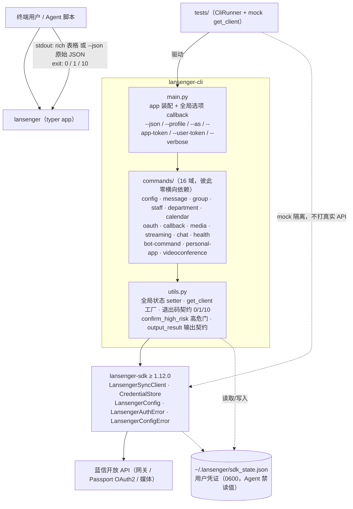

# 架构（docs/architecture.md）

> 定位：Harness ③结构层。模块地图 + 依赖方向 + **跨模块契约同步清单**。
> 事实源：pyproject.toml、main.py、utils.py、tests/ 实测 import 关系（2026-10-13 探测）；标注「推断」处为依赖配置推断。

## 1. 架构图

## 2. 模块职责

| 模块 | 职责 | 关键契约 |
|---|---|---|
| `main.py` | 注册 16 命令组；全局选项解析并写入 utils 状态；`--version` 显示 CLI+SDK 双版本 | 全局选项名（见 §3-C3） |
| `utils.py` | 共享运行时：状态 setter/getter、`get_client()`（profile + token 注入策略）、退出码、高危门、输出 | 退出码 0/1/10、`confirm_high_risk`、`output_result` |
| `commands/*.py` | 一个蓝信 API 域一个模块；参数校验 → （高危则过门）→ `get_client()` 调 SDK → `output_result` | 命令名与参数面 = 用户可见契约（5 README） |
| `tests/` | CliRunner 端到端驱动 + `MagicMock` mock `commands.<域>.get_client`；autouse fixture 重置全局状态 | 测试文件须与命令域镜像 |

**依赖方向**：`main → commands → utils → lansenger_sdk`（单向）。禁止：commands 互相 import、utils 反向 import commands、绕过 utils 直连 SDK（推断自现有代码一致性，无 lint 强制——演进项）。

## 3. 跨模块契约同步清单

> 改动下列任一项时，必须同一需求内同步所有「联动点」，逐项打勾后 verify 才算过。

| # | 契约 | 定义处 | 联动点（改动必同步） |
|---|---|---|---|
| C1 | **退出码** 0 成功 / 1 失败 / 10 高危未确认 | utils.py `EXIT_*` | 全部 commands 的失败路径 · tests/test_high_risk_gate.py · README「脚本集成」表述（5 语言）· AGENTS.md §3 |
| C2 | **高危门** `confirm_high_risk`（`--yes` 放行 / 无 `--yes` exit 10 结构化确认 / `--dry-run` 验参 exit 0） | utils.py:273 | 每个新增高危写命令 · tests/test_high_risk_gate.py · 5 README 对应命令示例 |
| C3 | **全局选项** `--json/-j --profile/-P --as --app-token --user-token --verbose/-v` | main.py callback + utils setter | 新全局选项须加 setter + fixture 重置 + 5 README 使用说明 |
| C4 | **输出形态** `--json` → 原始 JSON（stdout；失败信息 stderr）/ 默认 rich 表格 | utils.py `output_result` | 所有 commands 的展示代码 · README 示例（5 语言） |
| C5 | **配置键** `~/.lansenger/sdk_state.json` 键面 + `LANSENGER_*` 环境变量名 | config.py + SDK CredentialStore | config 命令 · 5 README「配置凭据」节 · AGENTS.md 红线引用 |
| C6 | **SDK 版本下限** `lansenger-sdk>=1.12.0` | pyproject.toml | CHANGELOG `dep:` 条目 · 全量 64 例回归 · 5 README（如有版本表述）· docs/architecture.md §2 SDK 版本 + C6 本行 |
| C7 | **版本三元组** pyproject `version` == git tag `v*` == CHANGELOG 最新条目 | release.yml 硬校验 | 发版流程：三处同 PR 改齐，tag 在合并后打 |
| C8 | **用户可见命令面** 命令名 / 参数 / 子命令树 | main.py 注册表 | **5 个语言版 README** 命令总览表 + 域章节 + tests 镜像；漏一份即漂移（0.14.0 移除 7 域为全量同步范例） |

## 4. 测试分层映射（对照宪法「测试左移」）

| 层 | 本仓落位 | 现状 |
|---|---|---|
| T0 纯函数 | utils 的输出格式化 / 参数解析 | 隐式（经 T1 覆盖） |
| T1 域逻辑 | `commands.<域>` 参数组装与结果处理 | 7/16 域有测试（config/health/media/videoconference/oauth/high-risk-gate/logging 等），64 例 |
| T2 集成 | CliRunner 全局选项 + 退出码 + 高危门 | ✅ test_high_risk_gate.py / test_cli_config.py |
| 缺口 | group/staff/department/calendar/callback/streaming/chat/bot-command/personal-app 无专门测试文件 | ⚠️ 演进项：新改动域必须补最小回归，存量渐进补齐 |

## 5. 运行时视图（推断）

- 无凭证/只读命令（`--help`、`config show`、`--version`、`callback` 解析类）可离线运行。
- 需凭证命令：`get_client()` 按 `--profile` 从 CredentialStore 装配；`--app-token/--user-token` 走外部注入（不自动刷新）；`--as <staff_id>` 自动加载并刷新 userToken。
- 失败路径：SDK `LansengerAuthError/LansengerConfigError` → 统一 `EXIT_ERROR=1`（retryable 时输出提示）。
